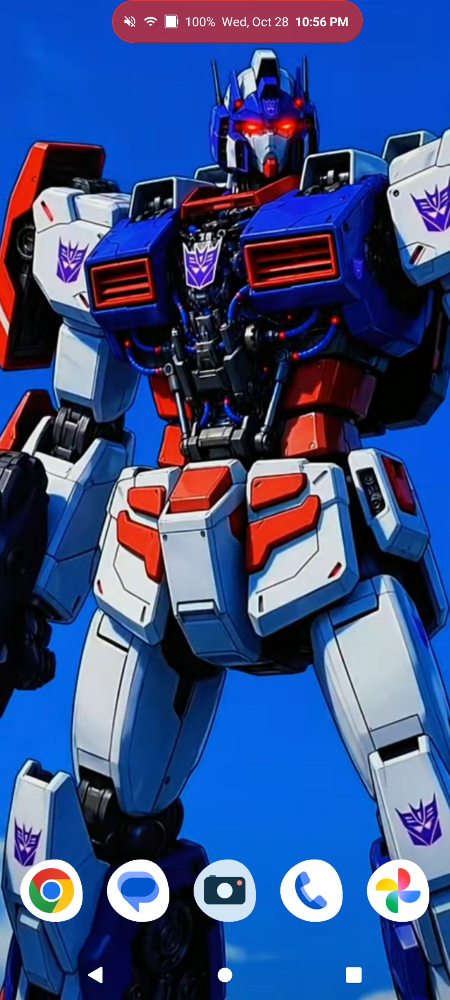
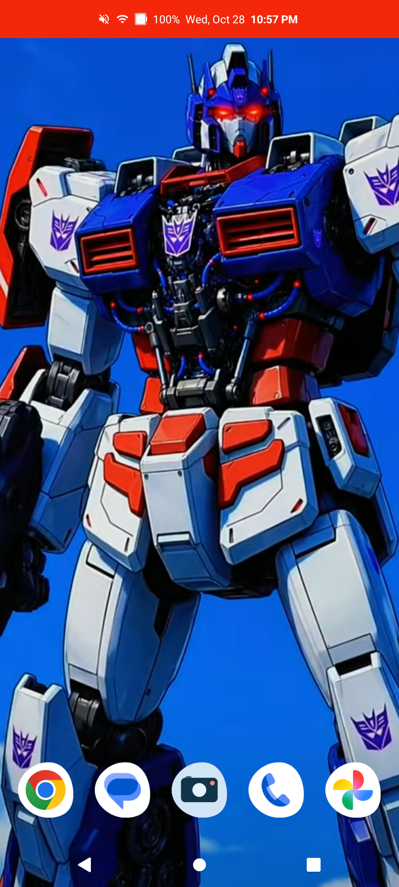

# DroidIsland

A dynamic-island style status bar for Android, drawn as an overlay above the system status bar. It mimics the iOS "Dynamic Island" but adapts to whatever Android lets a third-party app do: it hosts a compact pill at the top of the screen, shows live status (clock, battery, network, signal icons, media, timers), and expands into a notification / media / quick-tools / battery panel.

Built with Kotlin, no Jetpack Compose, no external UI libraries. Single Activity, single foreground Service, one optional AccessibilityService for trusted window overlays.

---

## Features

### The island

- **Collapsed pill** in the status bar strip, above the system bar, that shows (each item can be switched off, see *Island items*):
  - Clock and date (configurable format)
  - Battery percentage and a dynamically-drawn battery icon
  - Wi-Fi signal-level icon (0 to 4 arcs) when connected to Wi-Fi
  - Mobile network type (`5G`, `LTE`, `3G`, `2G`, or `Cell`) when on cellular
  - Status icons: airplane mode, Do Not Disturb, silent, vibrate, alarm, location, VPN, Bluetooth, battery saver
  - Live network down-speed
  - Notification icons for pending notifications
- **Expanded island** with multiple pages:
  - **Notifications**: app name, title, body, plus **Mute** and **Dismiss** buttons
  - **Media**: album art, title, artist, and play/pause/skip controls
  - **Timer**: stopwatch with start/pause/reset
  - **Quick tools**: flashlight, internet panel, Bluetooth settings, DroidIsland settings
  - **Battery**: percentage, charging state
- **Gestures**
  - Tap the pill, or swipe down on it, to expand
  - Swipe left/right to change page
  - Swipe up to collapse or dismiss a notification
  - Tap a notification to open its app
  - Long-press a notification to mute that app
  - Long-press the pill to open the settings app
- **Hidden on the lock screen**

### Settings

The settings app is organised in cards:

- **Setup**: permission status with a **Grant** button for each (draw over apps, notification access, accessibility service, phone state), plus **Start island**, **Stop island** and **Restart island**.
- **Start & reliability**: **Start on boot**, and **Run in background** (asks Android to stop pausing the island).
- **Position & padding**: alignment (left, center, right), horizontal offset, up/down offset, left padding (after the camera) and right padding, with **Reset position & padding**.
- **Appearance**:
  - Nine preset colors, a **Basics** row (black, white, grey) and three colors sampled from the current wallpaper (recalculated on startup and when the wallpaper changes)
  - A **Current** row showing the color applied to the island
  - **Glass** (see-through island) with an adjustable transparency, plus **Text size** and **Corner roundness**
- **Island items**: individual on/off switches for clock, battery, date, notification icons, network speed, Wi-Fi, mobile data, Bluetooth, airplane mode, Do Not Disturb, silent/vibrate, next alarm, location, VPN and battery saver. **Clock format** (system, 12-hour, 24-hour) and **Date format** (`Mon 26 Oct`, `26 Oct`, `10/26`) are here too.
- **Features**:
  - **Media controls**, **Stopwatch timer** and **Quick tools page**: turn each page on or off
  - **Notification pop-ups**: expand the island when a notification arrives, with **Pop-up time** and **Auto-close time** sliders
  - **Respect Do Not Disturb**: no pop-ups while Do Not Disturb is on
  - **Hide notification text**: pop-ups show only the app name
  - **Haptic feedback**: a tiny vibration when the island opens
  - **Low battery alert** (opens the battery page at 20%) and **Full charge alert** (tracks the state at 100%, no pop-up)
  - **Hide in landscape**
  - **Transparent over apps**: while an app is in front, the island background goes fully transparent. If the status bar cover is on, it is lifted while an app is in front so the transparency shows, and comes back on the home screen, lock screen and system UI. Needs Usage access. Text and icons get a flat contrasting outline (black around light content, white around dark) so they stay readable on any background, and the text color switches between light and dark automatically when the screen behind the pill can be measured (see the note under Requirements). The Setup card shows whether the measurement is working.
  - **Choose apps to show**: filter which apps appear in the island
  - **Stop pop-ups for an app**: pick an app and its own notification settings open, so you can turn off its system pop-up
  - **System heads-up pop-ups**: a global on/off switch for the system banner, shown only once `WRITE_SECURE_SETTINGS` is granted. If you turn them off, they are only off while the island is running and visible. They come back when the island stops, is hidden, or after a reboot where it doesn't start, and go off again when the island restarts.
  - **Send test notification**
- **Hide system icons**:
  - **Hide system icons** via `icon_blacklist`, so the real status bar's icons don't duplicate the island's, with **Also hide system clock** and **Also hide system battery**
  - **Copy command** (the ADB grant command) and **Restore system icons now**
  - **Cover the status bar**: an optional full-width bar drawn behind the pill to hide HUD chips (screen recording, USB connection, drag targets) from the top strip. The pull-down still works. The raised-button bevel around the pill is drawn only when the cover is off.
  - **Cover color**: **Island color** makes the cover match the island. **Wallpaper** uses the average color of the wallpaper strip the cover sits on. This is an approximation: it assumes a center-cropped portrait wallpaper and ignores launcher scrolling and custom crops. If the wallpaper image can't be read (live wallpapers, or no read access on some Android versions), it falls back to the wallpaper's primary color.
- **Hide in apps**: hide the island while chosen apps are in front, for example games or video players. Needs Usage access.
- **Backup & reset**: **Copy settings** to the clipboard as JSON, **Paste settings** to restore them, and **Reset all settings**.
- **Gestures**: a cheat sheet of the gestures above.

---

## Requirements

- Android 12 or newer (works from Android 8, but overlay reliability is much better from 12)
- The app needs to be given a few permissions that Android does not allow normal apps to grant themselves. All of them are covered below.

| Permission | Why |
|---|---|
| **Draw over other apps** (`SYSTEM_ALERT_WINDOW`) | Required to display any overlay window |
| **Notification access** | Required to read notifications and media metadata |
| **Accessibility service** | Required for `TYPE_ACCESSIBILITY_OVERLAY` windows, which are the only overlays the Android 12+ untrusted-touch filter allows to receive reliable touches |
| **Phone state** (`READ_PHONE_STATE`) | Required to read `dataNetworkType` for the `5G`/`LTE`/`3G`/`2G` label |
| **Fine location** (`ACCESS_FINE_LOCATION`) | Required on Android 10+ for `WifiManager.connectionInfo.rssi` to be non-redacted |
| **`WRITE_SECURE_SETTINGS`** | Optional. Needed only for the "Hide system icons" feature (`icon_blacklist`) and the in-app global heads-up switch (`heads_up_notifications_enabled`). Must be granted via ADB |
| **Usage access** | Optional. Needed only for the "Hide in apps" and "Transparent over apps" features (they need to know which app is in front) |

**Automatic text color over apps** reads the screen behind the island using the accessibility service's screenshot ability, which needs Android 11 or newer. If you build from source, make sure the accessibility service config in `res/xml` has `android:canTakeScreenshot="true"`, then turn the service off and on again in Accessibility settings. The Setup card shows "Auto text color over apps" with the current status. Until a measurement works, the text color follows the system light/dark theme and relies on the outline for contrast.

---

## Downloading a release

If a release `.apk` is published:

1. Go to the [Releases](../../releases) page.
2. Download the latest `droidisland.apk`.
3. Follow the **Install** section below.

---

## Install

### Android (manual)

1. Copy the APK to the phone.
2. Open it in your file manager. Allow "Install unknown apps" for the file manager when prompted.
3. Tap install.
4. Launch **DroidIsland**. The setup screen shows every required permission with a status badge and a **Grant** button. Grant them all, then tap **Start island**.

### Installing ADB

ADB (Android Debug Bridge) is needed to install the APK from a computer and, more importantly, to grant the [required `WRITE_SECURE_SETTINGS` permission](#️-required-adb-command). Pick your operating system below.

#### Windows

1. Download the **SDK Platform-Tools for Windows** ZIP from the [official download page](https://developer.android.com/tools/releases/platform-tools).
2. Extract the ZIP, for example to `C:\platform-tools`. The folder contains `adb.exe`.
3. *(Optional but recommended)* Add the folder to your `PATH` so you can run `adb` from anywhere:
   - Press **Win**, search for **Edit the system environment variables**, and open it.
   - Click **Environment Variables…**, select **Path** under *User variables*, and click **Edit**.
   - Click **New**, enter `C:\platform-tools`, and confirm with **OK**.
   - Close and reopen any Command Prompt / PowerShell windows.
4. Verify the install:
   ```powershell
   adb version
   ```
   If you skipped step 3, open PowerShell in the extracted folder and run `.\adb version` instead.

> **Tip:** If you have Android Studio installed, `adb.exe` is already at `%LOCALAPPDATA%\Android\Sdk\platform-tools` (PowerShell: `$env:LOCALAPPDATA\Android\Sdk\platform-tools`).

#### Linux

**Option A: package manager (easiest)**

```bash
# Debian / Ubuntu / Linux Mint
sudo apt update && sudo apt install adb

# Fedora
sudo dnf install android-tools

# Arch / Manjaro
sudo pacman -S android-tools

# openSUSE
sudo zypper install android-tools
```

**Option B: official Platform-Tools ZIP (always the latest version)**

```bash
cd ~
wget https://dl.google.com/android/repository/platform-tools-latest-linux.zip
unzip platform-tools-latest-linux.zip
echo 'export PATH="$HOME/platform-tools:$PATH"' >> ~/.bashrc
source ~/.bashrc
```

If you use zsh, replace `~/.bashrc` with `~/.zshrc`.

Verify the install:

```bash
adb version
```

### Preparing the phone for ADB

1. Enable **Developer options**: Settings → About phone → tap **Build number** seven times.
2. Enable **USB debugging**: Settings → System → Developer options → **USB debugging** → On.
3. Plug the phone into the computer with a USB **data** cable (some cables are charge-only).
4. On the phone, accept the **Allow USB debugging?** prompt and check **Always allow from this computer**.
5. Confirm the phone is detected:
   ```bash
   adb devices
   ```
   The phone should be listed with the status `device`. If it says `unauthorized`, re-check the prompt on the phone. If the list is empty, try another cable or USB port.

### Installing the APK with ADB

Windows (PowerShell / Command Prompt) and Linux use the same command. Replace the path with the location of your APK:

```bash
adb install droidisland.apk
```

To update an existing installation and keep its settings, add `-r`:

```bash
adb install -r droidisland.apk
```

Then launch **DroidIsland** on the phone and continue with the setup screen. Don't forget the [required ADB command](#️-required-adb-command) below.

### Troubleshooting ADB

| Problem | Fix |
|---|---|
| `adb: command not found` / `'adb' is not recognized` | The Platform-Tools folder is not on your `PATH`. Add it (see above) or run the binary by its full path. |
| `adb devices` shows nothing (Windows) | Install your phone manufacturer's USB driver, or the [Google USB driver](https://developer.android.com/studio/run/win-usb). |
| `no permissions` or `insufficient permissions` (Linux) | Your user lacks USB access. Install udev rules (`sudo apt install android-sdk-platform-tools-common` on Debian/Ubuntu) and replug the phone. Or run `adb kill-server && sudo adb start-server` as a quick test. |
| Device shows as `unauthorized` | Unlock the phone and accept the **Allow USB debugging?** prompt. If it doesn't appear, revoke USB debugging authorizations in Developer options and reconnect. |
| Device shows as `offline` | Run `adb kill-server`, unplug and replug the cable, then run `adb devices` again. |
| `INSTALL_FAILED_UPDATE_INCOMPATIBLE` | The installed copy was signed with a different key. Uninstall it first, then install again. |

---

- **Screenshots**
<br>&nbsp; &nbsp;&nbsp;&nbsp;

## ⚠️ Required ADB command

DroidIsland needs one permission that Android does not allow normal apps to grant themselves: **`WRITE_SECURE_SETTINGS`**. This is required for the "Hide system icons" feature, which is the whole point of the app — replacing the real status bar with the island.

After install:
Open a terminal with `adb` available (see [Install](#install) for setup) and run:

```bash
adb shell pm grant com.example.island android.permission.WRITE_SECURE_SETTINGS
```

After Uninstall:
Open a terminal with `adb` available (see [Install](#install) for setup) and run:

```bash
adb shell pm revoke com.example.island android.permission.WRITE_SECURE_SETTINGS
```

---

## Silencing system pop-ups

DroidIsland shows its own pop-ups, but Android's normal heads-up banners still drop down over the island. There are three ways to stop them, from gentlest to strongest.

### 1. Per app (no ADB needed)

Open DroidIsland, go to **Features**, and tap **Stop pop-ups for an app**. Pick an app and its notification settings open. Turn off the pop-up (heads-up / "pop on screen") option for that app or for the channel you care about.

### 2. Global switch in the app (needs `WRITE_SECURE_SETTINGS`)

Once the [required ADB command](#️-required-adb-command) has been run, a **System heads-up pop-ups** switch appears in the **Features** card. It turns the system pop-up banner off or on for every app.

The banner is only off while DroidIsland is running and visible. When you stop the island, hide it (Hide in apps, lock screen), or the phone reboots without starting it, the banner is switched back on, and it goes off again when the island comes back. If pop-ups were already off the first time DroidIsland sees the permission, it treats that as your choice and manages them the same way.

### 3. The nuclear option: turn off all pop-up notifications globally with ADB

This works without granting DroidIsland anything. With the phone connected and `adb` available, run:

    adb shell settings put global heads_up_notifications_enabled 0

To get pop-ups back:

    adb shell settings put global heads_up_notifications_enabled 1

Notes:

- This affects every app on the phone, not only DroidIsland.
- If you use the nuclear option and also grant `WRITE_SECURE_SETTINGS`, DroidIsland adopts the "off" state the first time it runs and from then on re-enables pop-ups whenever it stops. To keep them off permanently, run the ADB command again after stopping the island.
- Notifications still arrive in the shade and on the island. Only the system pop-up banner is suppressed.
- Some phone makers ignore this setting, in the same way some ignore `icon_blacklist`.
